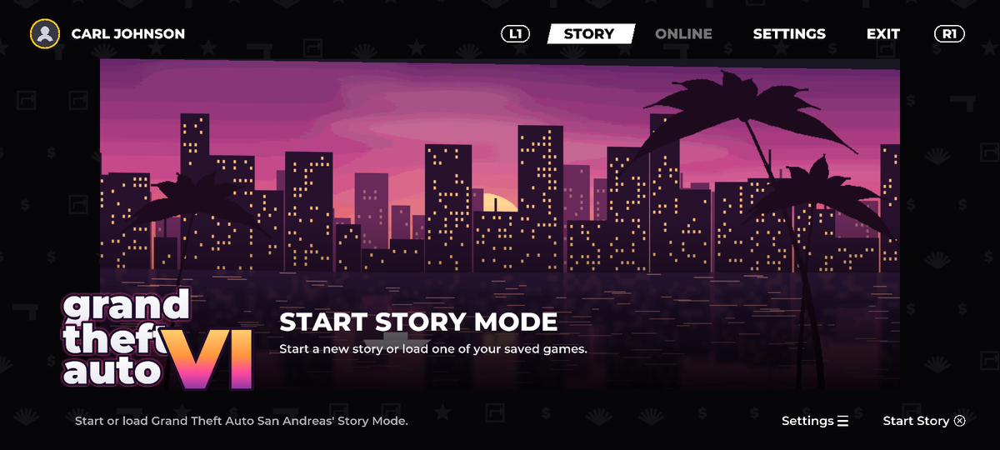
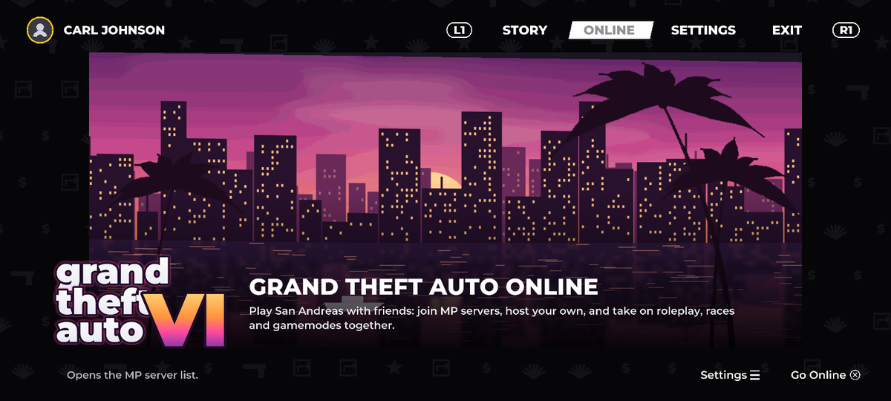
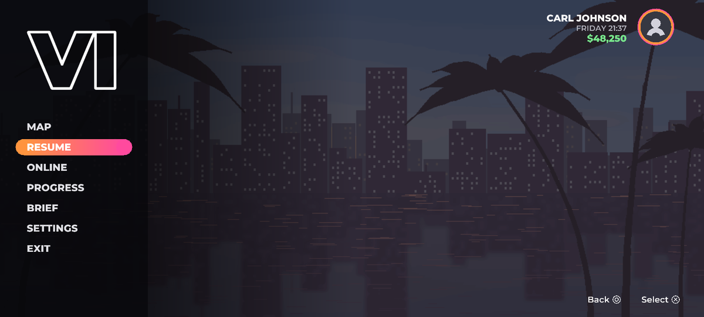
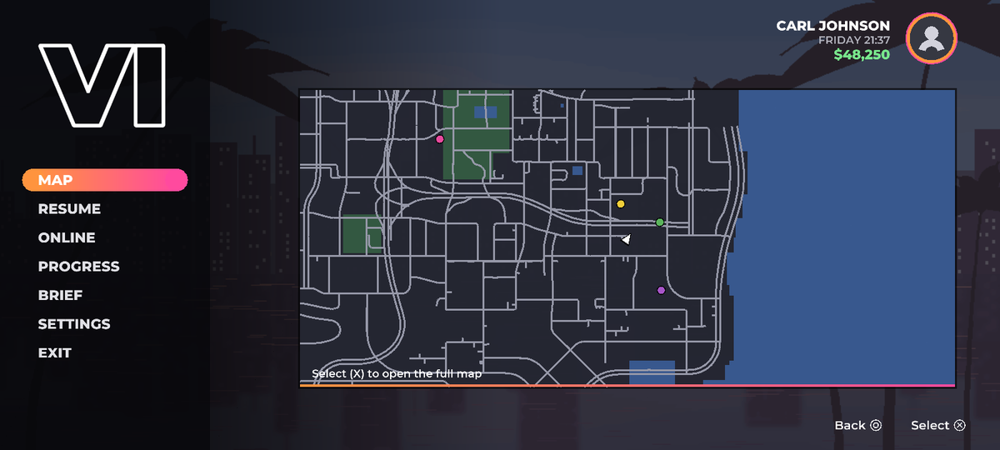
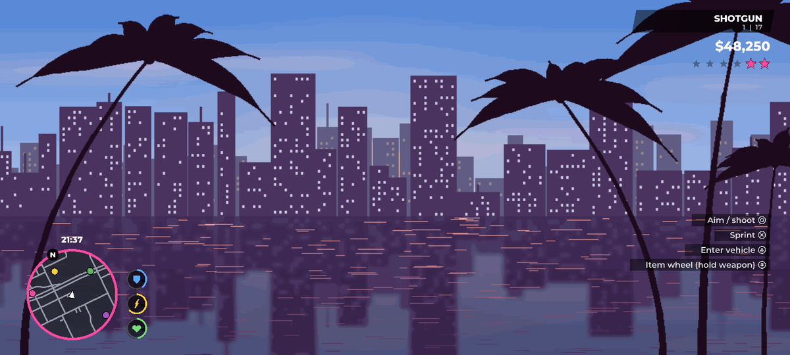
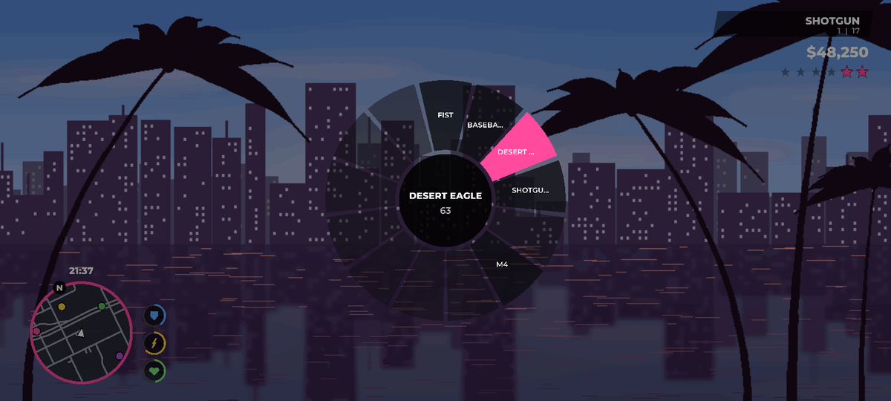
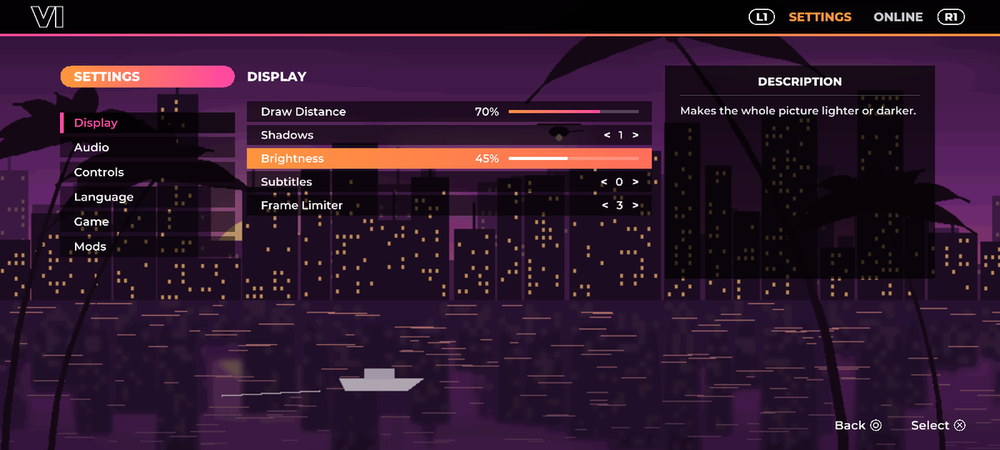
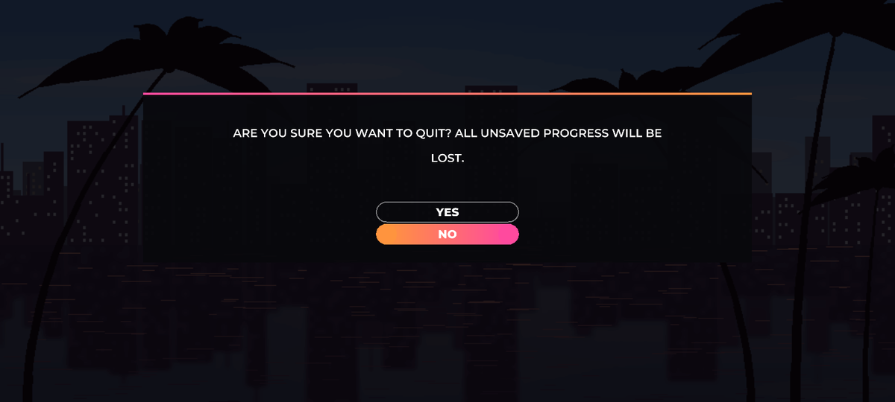
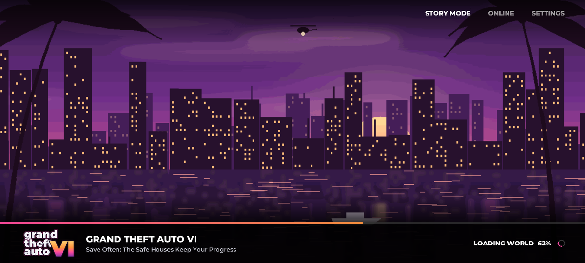

# Gta-VIHuds

**VIHud** gives GTA San Andreas Android a GTA VI style interface: the menus, loading screen, pause menu, HUD, radar, map, item wheel and settings. It is an AML mod built as `libVIHud32.so` (armeabi-v7a) and `libVIHud64.so` (arm64-v8a). The menu engine is based on PCMenu: it uses the same texture loading and painting method, restyled to the GTA VI look.

## Screens

The pictures below are rendered on a PC by `source/tools/vi_preview.cpp`. It runs the mod's real drawing code (`jni/vitheme.h`, `jni/vihud.h`, `jni/pcextra.h`) with the real `assets/VIHud` textures. They are not mock-ups.

| Main menu | Main menu (online) |
|---|---|
|  |  |

| Pause menu (transparent, fades in, shows your character) | Pause menu map |
|---|---|
|  |  |

| In-game HUD and round radar | Item / weapon wheel |
|---|---|
|  |  |

| Settings / display | Dialog | Loading screen |
|---|---|---|
|  |  |  |

## Features

- **Main menu** in the GTA VI style: art background, logo, a title next to the logo, and menu items with hover and select sounds (`select_menu.wav`, `back_menu.wav`).
- **Working loading screen.** Art slides cross-fade and a progress bar follows the game's real loading.
- **Transparent pause menu.** It fades in over the paused game, so you still see your own character behind it. It shows RESUME, the map, settings and the other entries.
- **New HUD.** Health, armour, money (with a +/- change popup), wanted stars, weapon and ammo, and the clock. `Hud=0` keeps the stock HUD.
- **Round radar with radar icons.** It also has a custom radar map, drawn from the game's map data (`jni/sa_map_data.h`) the same way the Mega Vil map is drawn. It sits bottom left by default, or top left with `HudRadar=top`.
- **Item / weapon wheel** with slot labels.
- **All UI components** are restyled: dialogs, lists, sliders, toggles, the settings / display pages and the in-game menus.
- **Safe start.** VIHud checks the game build, the symbols and the data folder first, and stays disabled (nothing hooked) when something does not match. Missing optional pictures fall back to plain drawing.

## Install

1. Install AML (Android Mod Loader) for GTA SA.
2. **Remove PCMenu first** (`libPCMenu32.so` / `libPCMenu64.so`). VIHud replaces it, because both hook the same menu.
3. Copy `libVIHud32.so` (32-bit game) or `libVIHud64.so` (64-bit game) into the AML mods folder.
4. Copy the `assets/VIHud` folder to `Android/data/<game package>/files/TYFMC/VIHud`.
5. Start the game. The log says `VIHud loaded`.

## Settings

`files/TYFMC/TYFMC.VIHUD.ini`:

| Key | Default | Meaning |
|---|---|---|
| `Hud` | `1` | `0` keeps the game's own HUD and radar. Only the menus change. |
| `HudRadar` | bottom | `top` puts the round radar top left |
| `PlayerName` | `CARL JOHNSON` | the name on the main and pause menus |

## Building

- **CI:** `.github/workflows/build.yml` builds both libraries with the NDK and uploads the `VIHud-binaries` artifact.
- **Locally:** run `ndk-build` in `source/` (`jni/Android.mk` has the `VIHud32` and `VIHud64` modules).
- **Textures:** `python3 source/tools/gen_vihud_assets.py` makes the `assets/VIHud` textures.
- **Previews:**

  ```
  cd source
  g++ -O2 -std=c++17 -D_WIN64 -DVIHUD -DPCMENU_TRANSPARENT -Ijni -Itools/stub -I<imgui> tools/vi_preview.cpp -o /tmp/vi_preview
  /tmp/vi_preview ../assets/VIHud /tmp/vi
  ```

## Credits

- The menu engine, texture loading and painting method come from PCMenu by ThirtyFoxMCx00E1.
- The GTA VI look follows Rockstar's GTA VI trailers and screenshots.
- This is a fan mod. It has no tie to Rockstar Games.
